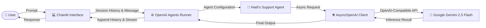

<div align="center">

# 🤖 Gemini Agent Chatbot
### *Next-Gen Autonomous Support Agent powered by OpenAI Agents SDK & Gemini 2.5 Flash*

[](https://python.org)
[](https://chainlit.io)
[](https://github.com/openai/openai-agents-python)
[](https://ai.google.dev)
[](https://github.com/astral-sh/uv)
[](LICENSE)

<br/>

**A production-ready conversational AI assistant that marries Google Gemini 2.5 Flash's ultra-fast reasoning with the robust OpenAI Agents SDK and a responsive Chainlit UI.**

[Key Features](#-key-features) • [System Architecture](#-system-architecture) • [Quick Start](#-quick-start) • [Project Structure](#-project-structure) • [Technical Highlights](#-technical-highlights)

</div>

---

## 🌟 Overview

**Gemini Agent Chatbot** is a modern Agentic AI application designed for conversational customer assistance and automated task execution. 

Unlike traditional wrapper chatbots that simply forward prompts to an API, this project implements the official **OpenAI Agents SDK** architecture with asynchronous orchestration, contextual session history, and model-agnostic provider routing to **Google Gemini 2.5 Flash**.

---

## ⚡ Key Features

- **⚡ Blazing Fast Responses:** Leverages Google's latest `gemini-2.5-flash` model via an OpenAI-compatible endpoint for sub-second, intelligent completions.
- **🧠 OpenAI Agents SDK Orchestration:** Built with `Agent`, `RunConfig`, and `Runner` patterns, laying the groundwork for multi-agent handoffs, guardrails, and tool calling.
- **💬 State-Aware Context History:** Tracks user session histories dynamically using Chainlit's session state, allowing multi-turn memory without context degradation.
- **🎨 Interactive Web UI:** Polished, responsive user experience out of the box with [Chainlit](https://chainlit.io), featuring real-time streaming and custom welcoming states.
- **⚡ Modern Packaging with `uv`:** Ultra-fast dependency resolution and virtual environment management via `uv` and `pyproject.toml`.

---

## 🏗️ System Architecture



---

## 🚀 Quick Start

### 1. Prerequisites
- Python 3.12 or higher
- [uv](https://github.com/astral-sh/uv) installed (recommended) or standard `pip`
- Google Gemini API Key ([Get one here](https://aistudio.google.com/))

### 2. Clone Repository
```bash
git clone https://github.com/SainBux-HadiSeelro/gemini-agent-chatbot.git
cd gemini-agent-chatbot
```

### 3. Setup Environment Variables
Create a `.env` file in the root directory:
```env
GEMINI_API_KEY=your_gemini_api_key_here
```

### 4. Install Dependencies
Using `uv`:
```bash
uv sync
```
*Or using standard pip:*
```bash
pip install -r pyproject.toml
```

### 5. Launch the Application
```bash
chainlit run chatbot.py -w
```
Your browser will open automatically at `http://localhost:8000`.

---

## 📁 Project Structure

```text
gemini-agent-chatbot/
│
├── .chainlit/            # UI configurations and localization files
├── chatbot.py            # Main application: Agent definition & Chainlit event loop
├── pyproject.toml        # Project dependencies and environment metadata
├── uv.lock               # Exact pinned dependency lockfile
├── README.md             # Project documentation & showcase
├── SPECS.md              # Technical system specifications
└── .gitignore            # Security filters (ignoring .env, .venv, etc.)
```

---

## 💡 Technical Highlights & Design Decisions

### 1. Model-Agnostic Agentic Bridge
The application configures OpenAI's `AsyncOpenAI` client with Google's Generative Language base URL:
```python
provider = AsyncOpenAI(
    api_key=os.getenv("GEMINI_API_KEY"),
    base_url="https://generativelanguage.googleapis.com/v1beta/openai/",
)

model = OpenAIChatCompletionsModel(
    model="gemini-2.5-flash",
    openai_client=provider,
)
```
This architectural decision allows leveraging cutting-edge Agentic frameworks (like OpenAI Agents SDK) while remaining fully decoupled from a single proprietary model provider.

### 2. Asynchronous Execution Pipeline
Agent runs are handled via `await Runner.run(...)` inside Chainlit's asynchronous message hook, ensuring the UI remains non-blocking and highly responsive during intensive reasoning loops.

---

## 🔮 Roadmap

- [ ] **Tool Calling:** Add live search, calculator, and custom API query tools.
- [ ] **Multi-Agent Handoffs:** Delegate specialized tasks to domain-specific subagents.
- [ ] **Persistent Memory Store:** Integrate SQLite or Redis for cross-session history persistence.
- [ ] **Docker Deployment:** Add single-command containerization for easy cloud deployment.

---

## 👨‍💻 Author

**Hadi Seelro**  
*Agentic AI Developer*  
- GitHub: [@SainBux-HadiSeelro](https://github.com/SainBux-HadiSeelro)

---

## 📄 License

This project is licensed under the [MIT License](LICENSE).
