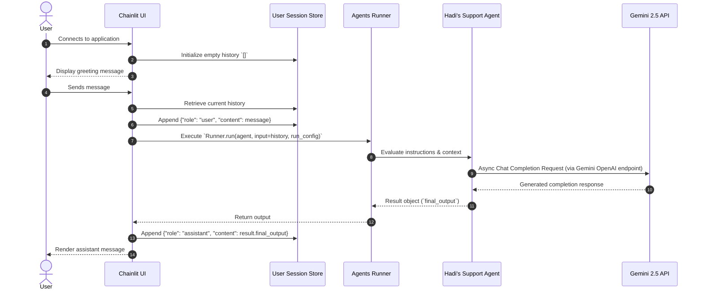

# 📐 Technical Specification (SPECS.md)

## Gemini Agent Chatbot Specification
**Project:** Gemini Agent Chatbot  
**Version:** 0.1.0  
**Author:** Hadi Seelro  
**Status:** Active / Production-Ready Demo  

---

## 1. System Overview
The **Gemini Agent Chatbot** is an asynchronous, agent-driven conversational system designed to demonstrate modern Agentic AI workflows. It integrates the OpenAI Agents SDK pattern with Google's Gemini 2.5 Flash model through OpenAI-compatible REST endpoints, wrapped inside a Chainlit web interface.

---

## 2. Architecture & Components

### 2.1 Component Breakdown

| Layer | Technology | Role |
| :--- | :--- | :--- |
| **Presentation** | Chainlit 2.5.5+ | Web interface, WebSockets communication, session state handling |
| **Agent Orchestration** | OpenAI Agents SDK (`agents`) | Agent lifecycle, `Runner`, `RunConfig`, message routing |
| **Model Adapter** | `OpenAIChatCompletionsModel` | Adapter converting agent schemas to OpenAI Chat Completions standard |
| **Inference Engine** | Google Gemini 2.5 Flash | High-speed LLM processing reasoning, intent parsing, and natural response |
| **Environment & Package** | `uv` / Python 3.12+ | Dependency locking, virtual environment management |

---

## 3. Data Flow & Execution Lifecycle



---

## 4. Functional Specifications

### 4.1 Session Management
- **Lifecycle Scope:** Per-browser connection / websocket channel.
- **State Storage:** In-memory `cl.user_session` retaining sequential turn history in standard OpenAI message dictionary format:
  ```python
  [
      {"role": "user", "content": "..."},
      {"role": "assistant", "content": "..."}
  ]
  ```
- **Context Preservation:** Entire active conversation history is provided to the Agent runner on each invocation to maintain conversational coherence.

### 4.2 Agent Configuration
- **Agent Name:** `Hadi's Support Agent`
- **Core Instructions:** *"you are a helpful assistant that can answer question and help with tasks."*
- **Execution Config:**
  - `tracing_disabled`: `True` (for clean, low-overhead inference).
  - Asynchronous event loop native compatibility (`asyncio`).

### 4.3 Model & Provider Specifications
- **Target Model:** `gemini-2.5-flash`
- **Protocol:** OpenAI Chat Completions API v1 compatibility.
- **Base Endpoint:** `https://generativelanguage.googleapis.com/v1beta/openai/`
- **Authentication:** Bearer token via `GEMINI_API_KEY` environment variable.

---

## 5. Security & Environment Configuration

1. **Secret Isolation:**
   - Keys are loaded strictly from root-level `.env` via `python-dotenv`.
   - `.env` is permanently excluded from version control via `.gitignore`.
2. **Error Handling & Tracing:**
   - Fallback protection against missing session keys (`cl.user_session.get("history") or []`).
   - Non-blocking async execution prevents server thread lockups during rate limits or network latency.

---

## 6. Extensibility Guidelines

### 6.1 Adding Function Calling / Tools
The `openai-agents` architecture natively supports tool injection. Future extensions can attach python functions directly into the `Agent` definition:
```python
from agents import tool

@tool
def get_weather(location: str) -> str:
    """Returns current weather data."""
    ...

agent1 = Agent(
    name="Support Agent",
    instructions="...",
    tools=[get_weather]
)
```

### 6.2 Multi-Agent Handoffs
Specialized agents (e.g., Billing, Technical Support, Triage) can be orchestrated by defining handoff protocols in `Runner.run`.
